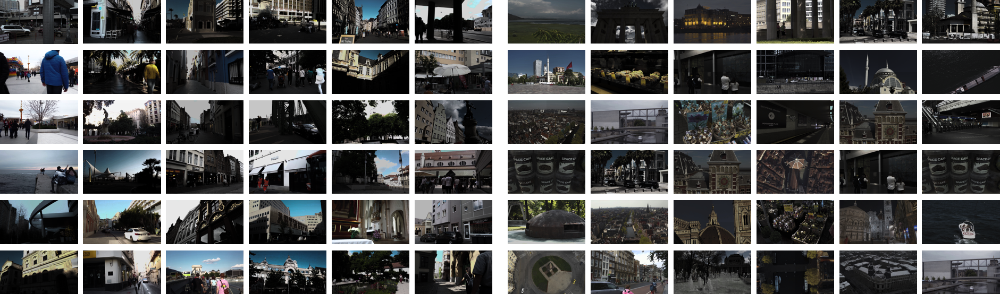
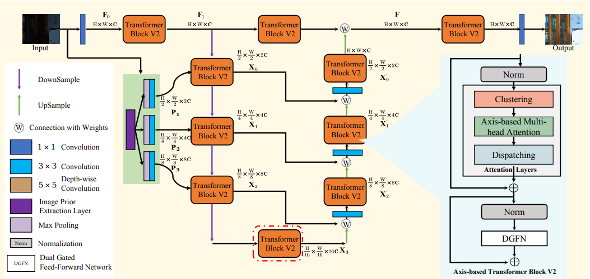
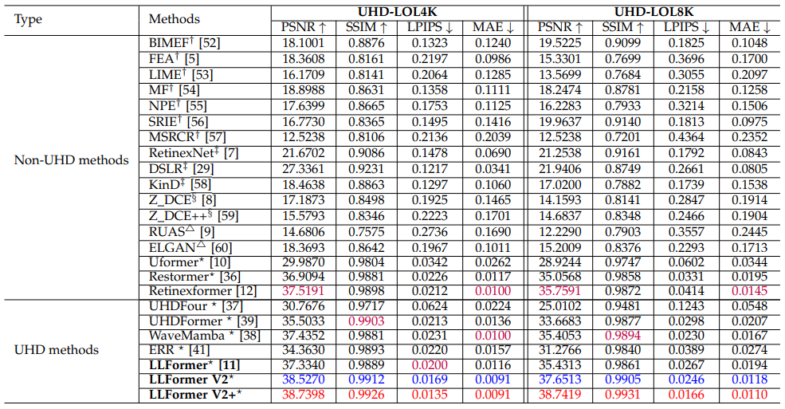
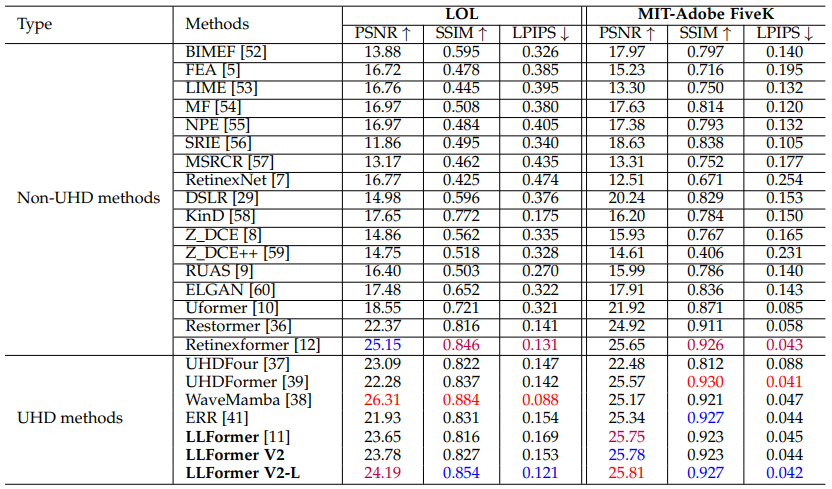
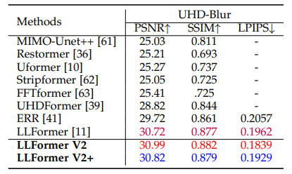
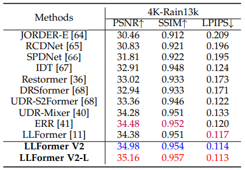

## LLFormer V2: Illumination-Aware Transformer with Semantic Fusion for UHD Low-Light Image Enhancement and Beyond


[Tao Wang](https://scholar.google.com/citations?user=TsDufoMAAAAJ&hl=en), Shenglong Hechen, [Bjorn Stenger](https://scholar.google.com/citations?user=plhjgHUAAAAJ&hl=en), [Tong Lu](https://cs.nju.edu.cn/lutong/index.htm), [Kaihao Zhang](https://scholar.google.com/citations?user=eqwDXdMAAAAJ&hl=en)

[](https://arxiv.org/pdf/2212.11548.pdf)
<!-- [](https://arxiv.org/pdf/2212.11548.pdf)
[](https://arxiv.org/pdf/2212.11548.pdf)
[](https://arxiv.org/pdf/2212.11548.pdf)
[](https://arxiv.org/pdf/2212.11548.pdf) -->

>**Abstract:** With the proliferation of ultra-high-definition (UHD) imaging devices, low-light image enhancement (LLIE) faces new challenges in both visual fidelity and computational efficiency. In this work, we introduce a large-scale UHD-LLIE benchmark, UHD-LOL, containing paired 4K and 8K low-light and reference images, and systematically evaluate existing LLIE algorithms under UHD settings. Building upon this benchmark, we propose LLFormer V2, a physically guided Transformer architecture that incorporates Illumination Prior Regularization (IPR) to explicitly embed multi-scale illumination cues into both the self-attention and feed-forward pathways. This physically informed design allows the model to disentangle illumination from reflectance, resulting in natural brightness recovery, robust color constancy, and improved perceptual consistency. To further enhance efficiency and representational power, we redesign the Axis-based Transformer Block into ATB V2, which employs a clustering–dispatching mechanism to adaptively fuse local and global features while maintaining computational tractability. Furthermore, we extend the framework to LLFormer V2-L, integrating high-level semantic priors from a frozen pre-trained Large Language Model (LLM) into the bottleneck to facilitate global contextual reasoning. Experimental results across diverse benchmarks demonstrate that the LLFormer V2 series achieve state-of-the-art performance in multiple tasks, such as UHD low-light image enhancement, UHD image deblurring, and UHD image deraining.

<!-- #### News
- **Jan 11, 2023:** Our paper is selected for an ORAL presentation at AAAI 2023
- **Dec 24, 2022:** Pre-trained models are released!
- **Dec 23, 2022:** Codes is released!
- **Dec 23, 2022:** Homepage is released! -->

<!-- This repository contains the dataset, code and pre-trained models for our paper. Please refer to our [project page](https://taowangzj.github.io/projects/LLFormer/) for a quick project overview. -->

## UHDLOL Benchmark for Image Enhancement


We create a new large-scale UHD-LLIE dataset called UHDLOL to benchmark the performance of existing LLIE methods and explore the UHD-LLIE problem. It consists of two subsets: UHD-LOL4K and UHD-LOL8K. The UHD-LOL4K subset contains 8, 099 pairs of 4K low-light/normal-light images. Among them, 5, 999 pairs of images are used for training and 2, 100 for testing. The UHD-LOL8K subset includes 2, 966 pairs of 8K low-light/normal-light images, which are split into 2, 029 pairs for training and 937 for testing.
<!-- Please refer to to our [project page](https://taowangzj.github.io/projects/LLFormer/) for more detail. -->
## Network Architecture


We propose LLFormer V2, an advanced Transformer-based framework for Ultra-High-Definition Low-Light Image Enhancement (UHD-LLIE). At its core, the model employs a Axis-based Transformer Block V2 (ATB V2), which enhances the original axis-based multi-head self-attention mechanism with a novel clustering-dispatching strategy​ to efficiently fuse local and global features while maintaining computational tractability. The framework also incorporates Illumination Prior Regularization (IPR), a physically-guided module that explicitly embeds multi-scale illumination cues into both the self-attention and feed-forward pathways, enabling more natural illumination recovery and robust color consistency. Furthermore, an extended version named LLFormer V2-L integrates a frozen pre-trained Large Language Model (LLM) into the bottleneck stage, injecting high-level semantic priors to enhance global contextual reasoning without additional training overhead.
## Quantitative results
### Results on UHD-LOL


### Results on LOL and MIT-Adobe FiveK


### Results on UHDBlur


### Results on 4K-Rain13k



## Get Started
### Dependencies and Installation
1. Clone Repo
```bash
git clone https://github.com/TaoWangzj/LLFormerV2.git
cd LLFormerv2
```
2. Create Conda Environment
```bash
conda create -n LLFormerv2 python=3.8
conda activate LLFormerv2
pip install -r requirements.txt
```

### Dataset
You can use the following links to download the datasets

1. UHD-LOL4K [[OneDrive](https://mailnwpueducn-my.sharepoint.com/:f:/g/personal/2018302756_mail_nwpu_edu_cn/EjqLBUb2ADxJhNIUpu-qFwABvbQcqboj9nIgOI4p-_0IZw) | [Baidu drive](https://pan.baidu.com/s/1APv_wBML734Wvb-Utpalig?pwd=s9bp)]
2. UHD-LOL8K [[OneDrive](https://mailnwpueducn-my.sharepoint.com/:f:/g/personal/2018302756_mail_nwpu_edu_cn/EhNBPOVCRAVLjQ_NarFmznkBAXw8m-ReCuYY92d3FtlW0Q?e=iIf9OS) | [Baidu drive](https://pan.baidu.com/s/1KdLg9sQoA8eeoFlg5p4pvQ?pwd=s6vf)]
3. LOL [[Link](https://daooshee.github.io/BMVC2018website/)]
4. MIT-Adobe FiveK [[Google drive](https://drive.google.com/drive/folders/1c33pXjeqX-Fwxc_yAozGQ0UlsSZ4IOqn?usp=drive_link) | [Baidu drive](https://pan.baidu.com/s/1z4sBVXdn8eJv1VpSI0LohA?pwd=yvhi)]
5. UHDBlur [[Link](https://github.com/supersupercong/UHDformer)]
6. 4K-Rain13k [[Link](https://github.com/cschenxiang/UDR-Mixer)]

### Pretrained Model
We provide the pre-trained models under different datasets:
- LLFormerv2 [Google drive | [Baidu drive](https://pan.baidu.com/s/1-sCNq_nhk1wnt9EGehVs8A?pwd=bw24)].

- LLFormerv2-L [Google drive | [Baidu drive](https://pan.baidu.com/s/1LAmXyT0MfOwOK9iHp_ajnw?pwd=pf12)].

### Visual comparison results
We provide the compared visual results. You can download from [[Baidu drive]](https://pan.baidu.com/s/1epdUOJ5ltFpQPeQdi3WJUQ?pwd=9bsb).

### Test
You can directly test the pre-trained model as follows
- Modify the `--option` in `test.sh` to `options/test/LLFormerv2.yml` if you want to test LLFormerv2, or to `options/test/LLFormerv2+.yml` if you want to test LLFormerv2-L.
- Specify the data path ```dataroot_gt```, ```dataroot_lq```, and model path ```pretrain_network_g``` in corresponding config files. Then run
```bash
sh test.sh
```

To calculate metrics for the test results
- Modify the data path `input` and `gt` in `measure.py` to the path of the test results and ground truth images, respectively. Then run
```bash
# test on rgb channel
python measure.py
# test on y channel
python measure.py --y
```


### Train

1. To download training and testing datasets

2. Train the model for non-UHD datasets (LOL and MIT-Adobe FiveK)
- Modify the `--option` in `train.sh` to `options/train/LLFormerv2.yml` or `options/train/LLFormerv2+.yml`, depending on the model you want to train.
- Change `--nproc_per_node` in `train.sh` to the number of GPUs you want use (default is 1).
- Specify the data path in corresponding config files. Then run
```bash
sh train.sh
```

3. Train the model for UHD dataset (UHD-LOL4K, UHD-LOL8K, UHDBlur, 4K-Rain13k)
- Modify the `--option` in `train.sh` to `options/train/LLFormerv2_UHD.yml` or `options/train/LLFormerv2+_UHD.yml`, depending on the model you want to train.
- Change `--nproc_per_node` in `train.sh` to the number of GPUs you want use (default is 2).
- Specify the data path in corresponding config files. Then run
```bash
sh train.sh
```


## Citations
If UHDLOL benchmark and LLFormer V2 help your research or work, please consider citing:

```
@inproceedings{wang2023ultra,
  title={Ultra-high-definition low-light image enhancement: A benchmark and transformer-based method},
  author={Wang, Tao and Zhang, Kaihao and Shen, Tianrun and Luo, Wenhan and Stenger, Bjorn and Lu, Tong},
  booktitle={Proceedings of the AAAI Conference on Artificial Intelligence},
  volume={37},
  number={3},
  pages={2654--2662},
  year={2023}
}
@inproceedings{zhang2021benchmarking,
  title={Benchmarking ultra-high-definition image super-resolution},
  author={Zhang, Kaihao and Li, Dongxu and Luo, Wenhan and Ren, Wenqi and Stenger, Bjorn and Liu, Wei and Li, Hongdong and Yang, Ming-Hsuan},
  booktitle={ICCV},
  pages={14769--14778},
  year={2021}
}
```


## Contact

If you have any questions, please contact taowangzj@gmail.com

---


## Our Related Works
- Benchmarking Ultra-High-Definition Image Super-resolution, ICCV 2021. [Paper](https://openaccess.thecvf.com/content/ICCV2021/papers/Zhang_Benchmarking_Ultra-High-Definition_Image_Super-Resolution_ICCV_2021_paper.pdf) | [Code](https://github.com/HDCVLab/UHD4K_UHD8K)
- MC-Blur: A Comprehensive Benchmark for Image Deblurring, arXiv 2022. [Paper](https://arxiv.org/pdf/2112.00234.pdf) | [Code](https://github.com/HDCVLab/MC-Blur-Dataset)
- Ultra-High-Definition Low-Light Image Enhancement: A Benchmark and Transformer-Based Method, AAAI 2023. [Paper](https://arxiv.org/pdf/2212.11548.pdf) | [Code](https://github.com/TaoWangzj/LLFormer)
---

## Reference Repositories
This implementation is based on / inspired by:
- HWMNet: https://github.com/FanChiMao/HWMNet
- Restormer: https://github.com/swz30/Restormer
- LLFlow: https://github.com/wyf0912/LLFlow
- BasicSR: https://github.com/XPixelGroup/BasicSR
<!-- - MambaLLIE: https://github.com/wengjiangwei/MambaLLIE
- GLMix: https://github.com/rayleizhu/GLMix -->

